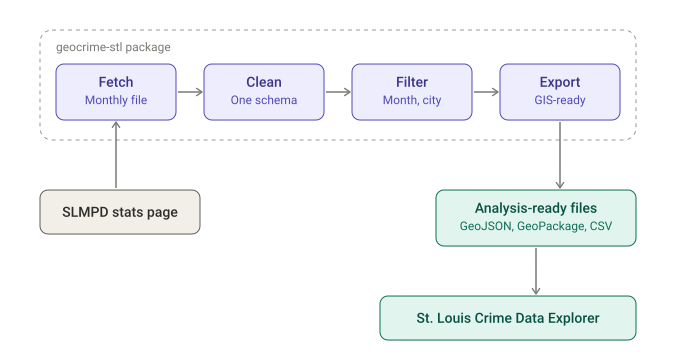
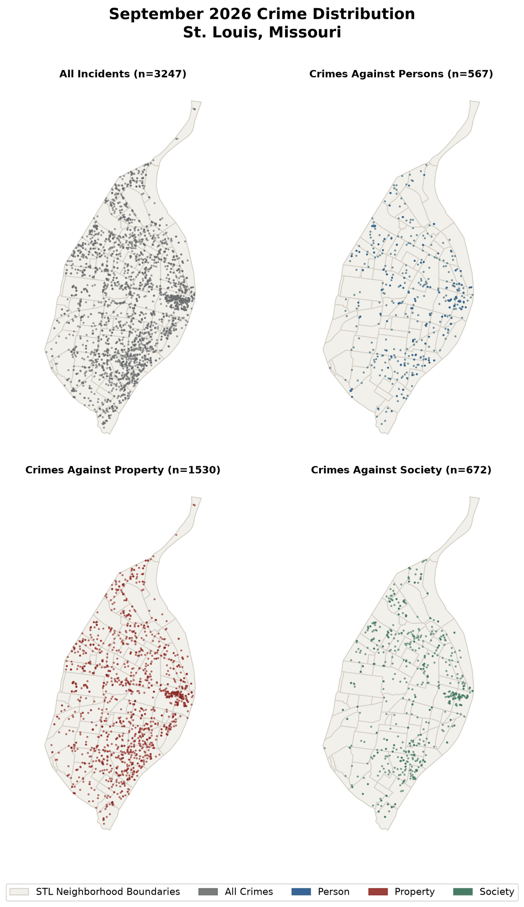

# geocrime-stl: Open-Source ETL for St. Louis Crime Data

## Overview

geocrime-stl is an open-source Python package that fetches, cleans, and standardizes monthly St. Louis Metropolitan Police Department (SLMPD) crime data so it is ready for spatial analysis. It is published on PyPI under the MIT License and is the data engine behind the [St. Louis Crime Data Explorer](crime-data-explorer.md).

**Study Area:** City of St. Louis, Missouri  
**Role:** Solo project (design, development, documentation, and publishing)  
**Status:** Released, version 0.2.0 (October 2026)

---

## Methods & Tools

**Data Source**

- Publicly available monthly crime files from the [SLMPD Stats page](https://www.slmpd.org/stats/). The package depends on that site's availability and URL structure.

**Processing Steps**

1. **Fetch** the monthly SLMPD file for the requested month and year.
2. **Clean and standardize** the records into a consistent schema.
3. **Filter by time** to keep only records from the target month, because SLMPD sometimes revises older records.
4. **Filter by space** to drop records whose latitude and longitude fall outside the City of St. Louis boundaries.
5. **Export** analysis-ready data as GeoJSON, GeoPackage, or CSV, with built-in monthly summaries and maps.

*The pipeline at a glance: one monthly file in, analysis-ready files out.*

A typical run is three calls: `run_pipeline(4, 2026)`, then `generate_monthly_metrics()` for a monthly summary, then `plot_monthly_maps()` for the map quad shown below.

**Example output**

`plot_monthly_maps()` draws a four-panel matplotlib figure showing where reported incidents fall, for all incidents and for crimes against persons, property, and society. This is September 2026 (3,247 incidents).

{ width="480" }

**Tools Used**

| Tool | Purpose |
|------|---------|
| Python 3.11+ | Package and pipeline code |
| GeoJSON, GeoPackage, CSV | Export formats for GIS and analysis tools |
| PyPI | Distribution (`pip install geocrime-stl`) |
| MkDocs Material | Documentation site with methodology page and API reference |
| Jupyter notebooks | Demo workflows for the ETL and hotspot analysis |
| Agentic, AI-assisted workflows | Used to build and document the package |

---

## Highlights

- Turns a manual monthly download-and-cleanup chore into a repeatable, scripted pipeline.
- Handles two data-quality issues that matter for mapping: revised historical records and coordinates that fall outside the city.
- Documented for other users: installation and usage guides, FAQ, changelog, API reference for the extract, transform, monthly summary, and export modules, and demo notebooks.

---

## Links

[View on PyPI](https://pypi.org/project/geocrime-stl/){ .md-button .md-button--primary }
[View Code on GitHub](https://github.com/lweber89/geocrime-stl){ .md-button }
[Documentation](https://lweber89.github.io/geocrime-stl/){ .md-button }
