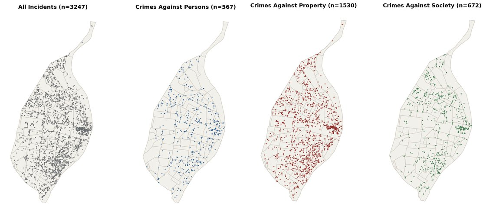
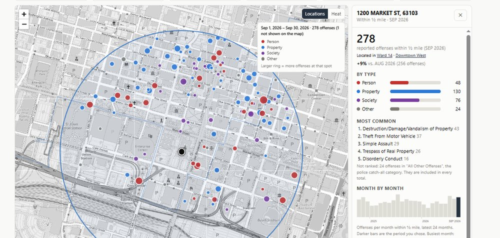

# Projects

A selection of my geospatial projects. Click any card to see the full write-up.

**[geocrime-stl](geocrime-stl.md)**

An open-source Python ETL package, published on PyPI, that fetches monthly St. Louis police crime data, cleans and standardizes it, clips it to the city boundary, and exports GeoJSON, GeoPackage, or CSV.

`Python` `ETL` `GeoJSON` `GeoPackage` `PyPI`

[View Project →](geocrime-stl.md){ .md-button }

**[St. Louis Crime Data Explorer](crime-data-explorer.md)**

An interactive dashboard that maps reported offenses by ward, neighborhood, or address radius, with hotspots, trend charts, and CSV export. Powered by geocrime-stl.

`Web mapping` `Spatial analysis` `NIBRS` `GitHub Pages`

[View Project →](crime-data-explorer.md){ .md-button }
[Open the Explorer →](https://lweber89.github.io/geocrime-stl/dashboard/){ .md-button }

